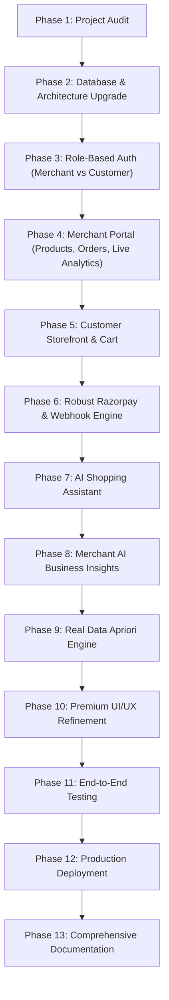

# MerchantPilot AI — Complete Project Audit & Gap Analysis
**Date**: November 23, 2026  
**Auditor**: Senior Full-Stack Software Engineer & Architecture Specialist  
**Application**: MerchantPilot AI (Production: `https://merchantpilot-ai.vercel.app`)  
**Scope**: Frontend SPA, FastAPI Backend, Authentication, Data Models, Payments, AI Services, Analytics, Tests & Serverless Deployment

---

## 1. Executive Summary

MerchantPilot AI is an AI-powered commerce enablement application built with React (Vite, Tailwind CSS, Recharts) and FastAPI (Python, SQLAlchemy, Razorpay SDK). The current application was originally developed as a proof-of-concept for the Razorpay AI Buildathon (Track 01: AI Growth & Agentic Commerce). 

While the core concepts—deterministic policy guardrails, agentic catalog representation, and Razorpay Test Mode checkout—are implemented and tested with 21 passing automated tests, the application contains significant architectural gaps, hardcoded mock data, security vulnerabilities, and database limitations that must be addressed to transform it into a true production-quality, multi-tenant **MerchantPilot AI 2.0** platform.

---

## 2. Existing Functionality & Working Features

| Module | Component | Current Implementation Status | Health |
|---|---|---|---|
| **Frontend** | React 18 + Vite | SPA with React Router 6, Tailwind CSS, Lucide icons, Recharts | ✅ Working (Builds in 20s, 0 errors) |
| **Frontend Routes** | `/`, `/dashboard`, `/ai-buyer`, `/catalog`, `/checkout`, `/policies`, `/revenue`, `/transactions`, `/audit`, `/login`, `/signup` | All routes render correctly with SPA `<div id="root">` | ✅ Working |
| **Authentication** | Password Hashing | PBKDF2-HMAC-SHA256 with 16-byte random salt and constant-time `hmac.compare_digest` | ✅ Working |
| **Authentication** | Sign Up & Sign In | `/api/auth/signup` and `/api/auth/signin` issue signed HMAC tokens | ✅ Working |
| **Catalog** | Agent Catalog | Structured JSON specifications, category filtering, stock availability | ✅ Working |
| **AI Buyer Demo** | `/api/agent/chat` | Natural language regex parsing, catalog search, affinity cross-sell recommendations | ✅ Working |
| **Policy Engine** | `/api/policies` | Guardrail checks: 10% discount ceiling, ₹6,000 max discount, prohibited action blocking | ✅ Working |
| **Payments** | Order Creation | `/api/checkout/create-order` creates pending orders with server-calculated amounts | ✅ Working |
| **Payments** | Signature Verification | `/api/razorpay/verify-payment` verifies HMAC-SHA256 payment signatures | ✅ Working |
| **Audit Trail** | `/api/audit/logs` | Structured audit event logging across agent, policy, and payment actions | ✅ Working |
| **Automated Tests** | Backend Test Suite | 21 passing tests covering catalog, agent, failure scenarios, policies, checkout, revenue | ✅ 21 Passed (0 failed) |

---

## 3. Broken, Incomplete & Simulated Features

### 3.1. Razorpay Webhook Processing Incomplete
- **Location**: `backend/app/api/razorpay.py` (lines 23–29) and `backend/app/services/razorpay_service.py` (lines 280–294)
- **Defect**: The webhook endpoint `/api/razorpay/webhook` only validates the signature header. It **does not parse the event payload** (`payment.captured`, `order.paid`, `payment.failed`).
- **Impact**: It does not transition orders to `PAID`, does not handle duplicate webhook events, does not record audit logs for webhooks, and does not provide an asynchronous fulfillment safety net if client-side redirects fail.

### 3.2. Ephemeral Cart System
- **Location**: `backend/app/services/agent_service.py` and `frontend/src/pages/AIBuyer.jsx`
- **Defect**: Cart items are ephemeral arrays passed in JSON requests. There is no persistent `Cart` or `CartItem` table in the database.
- **Impact**: Customers cannot save items in a cart, navigate away, or access their cart from another device.

### 3.3. Product Management is Read-Only
- **Location**: `backend/app/api/products.py`
- **Defect**: Only `GET /products` and `GET /products/{id}` exist.
- **Impact**: Merchants cannot create new products, update prices, manage inventory stock, or archive products through the API or UI.

### 3.4. Order Management is Read-Only
- **Location**: `backend/app/api/dashboard.py` (`/dashboard/transactions`)
- **Defect**: Merchants cannot change fulfillment status (e.g., `PENDING` → `CONFIRMED` → `SHIPPED` → `DELIVERED`). Customers cannot track order progress.

---

## 4. Hardcoded & Mock Data in Production Workflows

The repository contains several simulated or hardcoded values in core production API endpoints that violate the principle of real database-derived metrics:

1. **`backend/app/api/dashboard.py` (lines 41–49)**:
   ```python
   revenue_trend = [
       {"day": (now - timedelta(days=6)).strftime("%a"), "traditional_revenue": 145000, "ai_revenue": 45000, "bundles_sold": 6},
       {"day": (now - timedelta(days=5)).strftime("%a"), "traditional_revenue": 160000, "ai_revenue": 62000, "bundles_sold": 9},
       ...
   ]
   ```
   *Issue*: Revenue chart time-series data is completely fabricated with static numbers rather than aggregated from real database orders.

2. **`backend/app/api/dashboard.py` (line 54)**:
   ```python
   "total_ai_sessions": max(total_ai_sessions, 48)
   ```
   *Issue*: Injects a fake floor of 48 sessions if real sessions are lower.

3. **`backend/app/services/revenue_service.py` (lines 207–243)**:
   ```python
   bundles = [
       BundleOpportunity(bundle_id="bnd_dev_starter", title="Developer Starter Kit", ...),
       BundleOpportunity(bundle_id="bnd_creator_studio", title="Content Creator Pro Kit", ...),
       BundleOpportunity(bundle_id="bnd_remote_work", title="Ergonomic WFH Workstation", ...)
   ]
   ```
   *Issue*: Recommended bundle opportunities are hardcoded static models rather than dynamically generated from actual Apriori basket mining.

4. **`backend/app/services/revenue_service.py` (line 253)**:
   ```python
   conversion_rate = 24.8  # Mined simulated conversion
   ```
   *Issue*: Conversion rate is a static hardcoded float.

5. **`backend/app/services/revenue_service.py` (line 192)**:
   ```python
   upsell_revenue = sum(o.final_amount * 0.25 for o in ai_orders if not o.is_bundle)
   ```
   *Issue*: Upsell revenue is estimated using an arbitrary 25% multiplier.

---

## 5. Security & Authentication Risks

| Risk Area | Severity | Current State | Remediation Required |
|---|---|---|---|
| **Token Expiration** | 🔴 High | Signed tokens lack an expiration timestamp (`exp` claim). A token remains valid indefinitely. | Implement standard expiration (`exp` claim with 24h default) and validation. |
| **Role-Based Access Control** | 🔴 High | Endpoints lack role enforcement. Any authenticated user (including customer role) can access merchant policy settings, revenue insights, and transactions. | Create FastAPI role dependencies (`require_role("merchant")`, `require_role("customer")`). |
| **Multi-Tenant Isolation** | 🔴 High | Products, orders, and policies hardcode `merchant_id="m_1001"`. There is no check ensuring a merchant can only access their own data. | Add merchant ownership filter on all product/order queries based on `current_user.merchant_id`. |
| **Rate Limiting** | 🟡 Medium | Auth endpoints (`/auth/signup`, `/auth/signin`) have no rate limiting, vulnerable to credential stuffing. | Add rate limiting middleware or request throttling. |
| **Payment Signature Bypass in Dev** | 🟡 Medium | In dev mode, test signatures starting with `test_sig_` are accepted without cryptographic verification. | Ensure production environment strictly enforces HMAC-SHA256, and test mode uses valid Razorpay signatures. |

---

## 6. Database & Deployment Risks

### 6.1. Ephemeral SQLite on Serverless (`/tmp/merchantpilot.db`)
- Currently, when deployed on Vercel, the database copies to `/tmp/merchantpilot.db`.
- **Critical Risk**: AWS Lambda and Vercel serverless containers are stateless and ephemeral. The `/tmp` directory is destroyed whenever containers scale to zero or recycle. Any user registered in production, product created, or order placed is wiped on container reboot!
- **Solution**: Must connect to a persistent managed **PostgreSQL** database (e.g., Supabase, Neon, AWS RDS, or Vercel Postgres) via `DATABASE_URL` with SQLAlchemy + psycopg2.

### 6.2. Lack of Schema Migrations
- Schema creation currently relies entirely on `Base.metadata.create_all(bind=engine)`.
- If table columns change or new constraints are added, `create_all()` silently fails to alter existing tables.
- **Solution**: Set up **Alembic** migrations to manage deterministic schema changes.

### 6.3. Concurrency & Overselling
- Stock deduction in `razorpay_service.py` line 229:
  ```python
  if prod and prod.stock >= item.quantity:
      prod.stock -= item.quantity
  ```
- **Risk**: Without row-level locking (`with_for_update()`), concurrent orders for the same low-stock item can oversell.

---

## 7. Features That Must Be Preserved

1. **Commercial Policy Guardrail Engine**:
   - Deterministic mathematical policy validation (max discount %, max discount amount, max transaction amount).
   - Prohibited action blocking (refund, money transfer, arbitrary price override).
   - Human-in-the-loop approval gate.
2. **Razorpay Test Mode Integration**:
   - Official Razorpay SDK order creation and cryptographic HMAC-SHA256 signature verification.
   - Zero hardcoding of secret keys; reading strictly from environment variables.
3. **Machine-Readable Agent Catalog**:
   - Structured JSON endpoints (`/api/agent/catalog`, `/api/agent/products/{id}`, `/api/agent/availability`) with specs and compatibility graphs.
4. **Audit Trail Logging**:
   - Comprehensive audit log records with actor, session_id, action, decision, amount, and policy result.
5. **Apriori-Based Market Basket Mining**:
   - Mathematical formulation for Support, Confidence, and Lift on real order baskets.
6. **Frontend UI Aesthetic**:
   - Premium dark charcoal aesthetic, custom badge indicators, and responsive dashboard layout.
7. **Existing Test Suite**:
   - All 21 tests in `backend/tests/` must remain passing.

---

## 8. Existing Test Suite Execution Results

Ran `pytest backend/tests -v` on November 23, 2026:

```text
============================= test session starts =============================
platform win32 -- Python 3.12.5, pytest-9.1.1, pluggy-1.6.0
rootdir: D:\Making merchants AI-native and helping them grow revenue
configfile: pytest.ini
plugins: anyio-4.4.0, asyncio-1.4.0

backend/tests/test_agent_flows.py::test_scenario_1_successful_transaction_flow PASSED [  4%]
backend/tests/test_agent_flows.py::test_scenario_2_blocked_financial_action PASSED [  9%]
backend/tests/test_audit.py::test_audit_logging_and_filtering PASSED     [ 14%]
backend/tests/test_catalog.py::test_agent_catalog_structure PASSED       [ 19%]
backend/tests/test_catalog.py::test_product_search_and_filter PASSED     [ 23%]
backend/tests/test_catalog.py::test_batch_inventory_check PASSED         [ 28%]
backend/tests/test_catalog.py::test_single_product_details PASSED        [ 33%]
backend/tests/test_failure_scenarios.py::test_out_of_stock_failure_handling PASSED [ 38%]
backend/tests/test_failure_scenarios.py::test_invalid_signature_payment_rejection PASSED [ 42%]
backend/tests/test_failure_scenarios.py::test_policy_violation_audit_recording PASSED [ 47%]
backend/tests/test_policy_engine.py::test_compliant_discount_passes PASSED [ 52%]
backend/tests/test_policy_engine.py::test_excessive_discount_percentage_blocked PASSED [ 57%]
backend/tests/test_policy_engine.py::test_excessive_transaction_amount_blocked PASSED [ 61%]
backend/tests/test_policy_engine.py::test_restricted_action_blocked PASSED [ 66%]
backend/tests/test_policy_engine.py::test_offer_service_bounded_generation PASSED [ 71%]
backend/tests/test_razorpay_checkout.py::test_create_checkout_order_api PASSED [ 76%]
backend/tests/test_razorpay_checkout.py::test_payment_signature_verification_success PASSED [ 80%]
backend/tests/test_revenue_intelligence.py::test_market_basket_association_mining PASSED [ 85%]
backend/tests/test_revenue_intelligence.py::test_cross_sell_recommendations PASSED [ 90%]
backend/tests/test_revenue_intelligence.py::test_upsell_recommendations PASSED [ 95%]
backend/tests/test_revenue_intelligence.py::test_revenue_insights_endpoint PASSED [100%]

====================== 21 passed, 2272 warnings in 9.31s ======================
```

---

## 9. Recommended Upgrade & Migration Strategy



### Key Migration Principles:
1. **Zero Disruption to Existing Tests**: Maintain backward compatibility with existing tests by ensuring base models and API response shapes remain consistent.
2. **PostgreSQL & Dual Database Support**: Support PostgreSQL via `psycopg2` when `DATABASE_URL` starts with `postgresql://` or `postgres://`, while maintaining SQLite support for local rapid test execution.
3. **Data Preservation**: Seamlessly migrate existing seed catalog and policy models to new schema structures without losing catalog records.
4. **Remove All Mock Metrics**: Replace hardcoded trend dictionaries, static bundles, and arbitrary percentages with live SQL aggregation queries.
